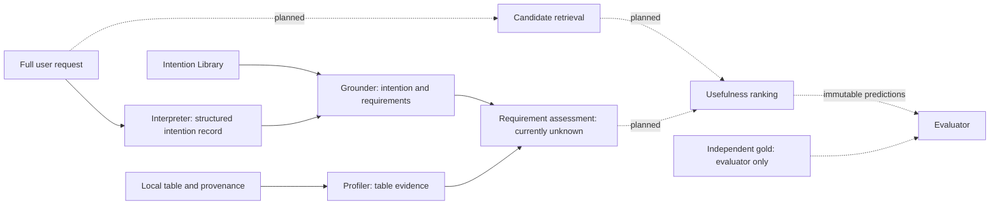

# Intention-grounded table discovery

**This README is the main project guide.** It brings together the architecture, current implementation, datasets, baselines, LLM requirements, testing strategy and next steps. Detailed research contracts remain supporting appendices; historical design files are not alternative starting points.

The research question is: **does procedure-grounded assessment improve intended-usefulness ranking over strong baselines receiving the same full request?** A table can mention the right topic yet lack the observations, population, units, time coverage or prediction-time features needed for the requested use.

> Current state: a working offline demonstrator and validated software contracts, not a completed discovery benchmark. The aligner still returns `unknown`; retrieval, usefulness ranking and benchmark evaluation are not implemented. No model has been established as the best performer.

## Start here: supervisor demonstration

Use Python **3.10+** from the repository root. Create a project environment if you do not already have one; leave the older parent-directory environment untouched.

```sh
python3 -m venv .venv
./.venv/bin/python -m pip install -e .
./.venv/bin/python -m intention_grounding.dashboard
```

Open **http://127.0.0.1:8765**. If the port is occupied, add `--port 8766`. Stop with Ctrl+C. The interface binds only to the local machine. It needs no Node build, GPU, model weights, API key or external web resources. Installation needs the two runtime dependencies, `jsonschema` and `python-dotenv`; after installation the demo runs offline.

On macOS, after setup you can also double-click **`run_demo.command`** to start the server in Terminal. The installed `intention-demo` command is equivalent. Tests in the interface require a source checkout containing `tests/`, rather than only an installed wheel.

### Five-minute presentation route

1. **Framework:** show the research question and the implemented/planned stage labels. Library counts are read from the actual catalog.
2. **Pipeline demo:** run the fixed Compare example. Inspect the synthetic input table, exact text evidence, bound intention, requirements, primitive profile and unknown verdicts. Stored model responses pass through the real interpreter/grounder/profiler/aligner; no LLM inference occurs.
3. **Intention Library:** open `compare.time`, then `predict.forecasting`. Explain why a catalog definition is different from runtime support and why procedure alternatives remain separate.
4. **Verification:** run an ambiguous or malformed replay case, then the actual offline unittest suite. An expected rejection is a passing contract check. Results are measured on demand, not screenshots of invented scores.
5. **Models & study:** explain the proposed datasets, model roles, fair baselines and evaluation gates. Export the last pipeline, replay or test report as JSON using the top-right button.

The fixed demo is deliberately not a free-form chatbot. Changing a request would require a real model response or another explicitly authored fixture. The UI offers no paid calls. Exported pipeline/test reports include source identity and timing; preserve the corresponding local source changes when reproducing a report. A dirty working tree is labeled.

## Architecture



The local interface calls the same components as the canonical CLI. It adds presentation and test reporting, not a competing analytical pipeline.

| Component | Current behavior | Remaining work |
| --- | --- | --- |
| Interpreter | Validates structured responses, exact Unicode evidence spans, roles, ambiguity and relationships; supports manual replay and an optional Groq adapter. | Independent semantic accuracy evaluation; broader role binding. |
| Intention Library (IL) | v0.2 draft: 23 families, 62 concrete intentions, 66 procedure definitions; inheritance, references and capability validation; offline inspection. | Scientific review and empirical validation. Coverage is not exhaustive. |
| Grounder | Grounds three direct-observation Compare intentions; rejects abstract, malformed and catalog-only selections. | Complete handling of joint goals, full-grid requests and alternative procedures at runtime. |
| Profiler | Reads CSV/JSON, records columns, primitive types, missingness, numeric summaries and file hashes. | Semantic units/populations/relations; header-only CSV and boolean type fixes. |
| Assessment / aligner | Conservatively returns `unknown` for each requirement. | Evidence-linked supported/violated/unresolved decisions. |
| Retriever and ranker | Not implemented in the current package. Explicit CLI table paths are not retrieval. | Full-request candidates, candidate recall, per-procedure assessment and justified ranking/abstention. |
| Experiment runner | CLI saves unique run artifacts; interface runs replay and tests and exports reports. | Config-driven benchmark runs, baseline adapters, metrics, costs and frozen result reports. |

### Core contracts and strategies

- **Request → structured intention record:** preserve exact wording and source evidence. Competing interpretations remain ambiguous; missing arguments remain unresolved. Valid JSON and matching spans do not prove semantic correctness.
- **Record + IL → grounded intention:** resolve an intention and its role bindings; retain applicable procedures separately. Inheritance shares requirements, not execution order. Joint goals are `all_of`; explicitly accepted alternatives are `any_of`. Ambiguity is not an accepted alternative.
- **Table → evidence:** identify the source, bytes/hash, scan scope and extraction method. Primitive statistics do not establish units or population compatibility.
- **Requirements + evidence → verdicts:** supported and violated require cited evidence; missing or conflicting evidence remains unresolved. Current artifacts use legacy `unknown`; a future versioned boundary maps it to `unresolved`.
- **Candidates + assessments → ranking (proposed):** retain separate procedures, deterministic ties and an abstention policy. A supported/unresolved/violated ordering with retrieval-score fallback is a proposal requiring validation, not a settled scientific formula.
- **Runtime → evaluator:** gold labels must be inaccessible to candidate generation, profiling and ranking. Predictions are frozen before evaluation.

Compare initially means **direct observations**, without aggregate-then-compare. Predict definitions include **classification, regression, forecasting and survival**; these remain catalog-only. No universal minimum sample size, quality threshold or weighted score has been invented to declare suitability.

## Intention Library

Canonical file: [action-base-v0.2.json](intention_grounding/docs/ab_proposal/action-base-v0.2.json). Families cover compare, retrieve, summarize, aggregate, associate, predict, cluster, detect, explain, test, estimate, monitor, integrate, prepare, validate, visualize, recommend, optimize, simulate, spatial, network, text and discover.

Only `compare.groups`, `compare.groups.trajectories` and `compare.time` support grounding. The other 59 concrete intentions are definitions awaiting runtime integration. No analytical executor is implemented. Causal explanation, predictive association and model explanation are distinct.

```sh
./.venv/bin/python -m intention_grounding.cli --list-intentions
./.venv/bin/python -m intention_grounding.cli --intention predict.forecasting
```

`--il PATH` selects a library; `--ab` remains a compatibility alias. Frozen v0.1 remains loadable for reproducibility. Existing serialized `actions`, `action_id`, `ab_version` and `grounded_card` fields are compatibility spellings, not different research concepts. Breaking renames require a versioned migration.

## Datasets and annotation strategy

| Source | Actual status | Intended use and constraints |
| --- | --- | --- |
| Bundled income CSV | Four synthetic rows; available now. | Pipeline/profile contract demonstration only. |
| Interpreter replay fixtures | 13 manually authored responses, including expected invalid cases. | Schema, evidence, ambiguity and failure checks; not LLM predictions. |
| Legacy `data/`, `results/`, notebooks | Retained historical assertions and outputs; provenance incomplete. | Not independent request-table usefulness gold or reproduced retrieval evidence. |
| UCI/OpenML | Proposed main real-table corpus; bounded earlier feasibility inspection, no finalized benchmark. | Independently annotate Compare/Predict requests and usefulness. Pin licenses, bytes, source-family identity and mirrors. |
| FollowTable | Proposed external track; released protocol and compatibility need explicit mapping. | Instruction-following labels do not automatically establish procedural usefulness. Resolve licensing, parsing and source-family overlap. |
| Original semantic-matching/TABERTA data | Optional native-task regression track. | Resolve exact artifacts/serialization and training overlap. Topical labels are not usefulness labels. |
| WikiDBs metadata fixture | Marked not acquired; no archive verified in this checkout. | Possible future source; never treat the metadata file as downloaded data. |

A versioned corpus manifest must carry source URL, acquisition/version, license, table and source-family IDs, raw/normalized hashes and transformations. Requests need separate topical and intended-usefulness judgments. Labels are **useful / not useful / unresolved**, with independent evidence and adjudication; never generate gold from the IL predicates being evaluated.

Discovery development/validation/test partitions must be disjoint by **topic and source-table family**, including mirrored or derived tables. Too few independent families means a development-only pilot, not an artificial holdout. Prediction has separate row/entity/time splits; preprocessing is fitted only on training rows, and held-out outcomes/post-outcome features cannot inform suitability ranking.

## Baselines and experiment strategy

All primary baselines receive the **same full request**, including intention and constraints. Match public table evidence and budgets; record truncation. Do not give only our method extra documentation or semantic evidence.

| Baseline | Status | Integration needed |
| --- | --- | --- |
| BM25 | Planned; historical implementation is a reuse candidate. | Review tokenization, fields, parameters and tie behavior; verify hand-computed examples. |
| Our semantic-matching method, EDBT 2025 | Blocked for faithful reproduction. | Resolve exact implementation/variant, ExS/ANNS/CTS behavior, encoder and serialization. Generic cosine similarity is not a substitute. |
| TABERTA | Blocked for a faithful run. | Pin actual checkpoint/subfolder, tokenizer, pooling, table view, license and reference outputs. |
| Qwen3 embeddings | Candidate selected for planning; adapter not integrated. | Query instructions, correct pooling/normalization, corpus serialization, index and pinned revisions. |
| Qwen3 reranker | Planned. | Official pair formatting/scoring, identical candidates and measured resource budget. |
| Direct LLM usefulness | Planned. | Full-request/evidence assessment without IL decisions or gold; structured verdict, citations and abstention. |

**Controlled reranking first:** all methods score identical candidate IDs, or the entire small pilot partition. Freeze the pool without inserting gold positives. This separates assessment quality from candidate selection.

**End-to-end retrieval second:** search the same corpus; report candidate recall as well as final quality. Reranking cannot recover useful tables absent from the candidate pool.

**Proposed ablations:** full request versus topic-only request; retrieval-only versus procedure-grounded assessment; evidence-matched direct LLM versus IL-grounded assessment. Freeze these choices before held-out evaluation. No fine-tuning is required for the pilot.

Primary metric is **usefulness nDCG@10**, using the complete eligible corpus judgment universe for the ideal ranking. Also report Success@1, Recall@10, requirement-verdict macro-F1, false-support rate, grounding/verdict/recommendation coverage, candidate recall, latency and cost. Unresolved/unjudged items are not assigned negative labels. No-positive requests have undefined nDCG/recall and a separate abstention analysis. Eligibility, failures, exclusions and uncertainty must be explicit. Exact denominators and incomplete-judgment conventions are in the evaluation appendix.

**No retrieval scores, model leaderboard or superiority results are available yet.** The small initial experiment will be a pilot.

## LLMs: roles, requirements and best-fit selection

The offline interface uses no LLM. The optional live pipeline makes up to two generation calls: one to interpret the request and one to propose IL bindings. Deterministic code validates both; an LLM does not directly certify table usefulness.

| Role | Candidate / capability | What must be provided | How fit will be measured |
| --- | --- | --- | --- |
| Interpreter | Instruction-following model via existing Groq adapter | Key, permitted model ID, optional SDK, JSON-object output, context for exact request + schema, bounded output. | Schema validity, intention/argument fidelity, exact evidence, ambiguity handling, latency and cost. |
| Grounder | Same adapter, constrained IL proposal | Structured record + allowed IL subset, sufficient prompt context, valid IDs/bindings and no invented evidence. | Correct selections/roles, unsupported/ambiguous handling and preservation of all required goals. |
| Dense retrieval | Proposed `Qwen/Qwen3-Embedding-0.6B` | Pinned model/tokenizer, supported inference libraries, faithful query/table formatting, pooling, normalization and index. | Candidate recall, usefulness ranking, indexing time, memory and throughput. |
| Reranking | Proposed `Qwen/Qwen3-Reranker-0.6B` | Request–table pairs, official scoring, candidate pool, token limits and inference resources. | nDCG/Success/Recall on identical candidates, per-pair latency and cost. |
| Direct usefulness baseline | Instruction-following local or hosted model | Same public evidence, structured cited judgments, unresolved option, fixed version/prompt and budget. | Usefulness quality, false support, evidence fidelity and abstention. |

The small Qwen variants are **practical candidates to evaluate**, not established winners. For tomorrow, **manual replay is the best fit for a reliable demonstration** because it removes provider, network, cost and nondeterminism dependencies. For live use, select an account-accessible model only after compatibility and independent semantic checks.

Hosted inference requires network/account access and an explicit token/spend budget; the local client needs no model GPU. Local inference needs downloaded weights, tokenizer/runtime dependencies, disk and enough RAM/VRAM for weights **plus** activations, sequence length, batch size and caches. Arithmetic example: 0.6 billion parameters × 2 bytes is approximately 1.2 GB of weights alone, not a minimum-machine specification. Measure actual peak memory, truncation and throughput on the intended hardware before choosing a model size or quantization.

Prompt tokens + reserved output must fit the selected model's context window. The current adapter requests JSON-object output and then validates locally; JSON syntax alone does not guarantee schema compliance or semantic truth. Strict provider schema-output support is model-specific and is not currently implemented by this adapter. Pin model IDs/revisions, prompt versions, generation settings, retries and timeouts; no silent model substitution.

Use development data to debug, validation data to choose the quality/false-support/coverage/latency/cost tradeoff, then freeze before test evaluation. Report p50/p95 latency, token counts, failures and memory where relevant. There is no justified universal “best LLM” without those measurements.

Official references checked for this guide: [Groq structured outputs](https://console.groq.com/docs/structured-outputs), [Qwen embedding model card](https://huggingface.co/Qwen/Qwen3-Embedding-0.6B), [Qwen reranker model card](https://huggingface.co/Qwen/Qwen3-Reranker-0.6B). These establish supported formats and model roles, not results on our framework.

### Optional live CLI, separate from the demo

```sh
./.venv/bin/python -m pip install -e '.[groq]'
cp -n .env.example intention_grounding/.env
# Edit that ignored file locally: GROQ_API_KEY and GROQ_MODEL_ID.
./.venv/bin/python -m intention_grounding.cli --list-models
```

Listing models is an authenticated API request. Use an ID available to your account; the code contains no default “best” model. Keep credentials out of command arguments, notebooks and Git. Exported environment variables take precedence over the file; `--model` overrides the configured model ID.

```sh
./.venv/bin/python -m intention_grounding.cli --mode groq \
  --input-id request-1 --input 'Compare annual income in France in 2019 versus 2021.' \
  --dataset /absolute/path/table.csv \
  --dataset-metadata /absolute/path/source-metadata.json --output outputs/live
```

Always supply truthful metadata for custom tables: the existing CLI otherwise defaults to inappropriate WikiDBs metadata, a known issue awaiting implementation work. Live results still receive unknown assessment; live interpretation is not completed retrieval.

## Testing and reproducibility

```sh
./.venv/bin/python -m unittest discover -s tests -v
./.venv/bin/python -m intention_grounding.cli --mode offline --output outputs/pipeline
./.venv/bin/python -m intention_grounding.interpreter.demo --output-root outputs/replay
```

| Layer | What we actually test | What passing does not establish |
| --- | --- | --- |
| Interpreter contracts | Schema closure, references, Unicode offsets, normalization, ambiguity, invalid JSON and safe provider failures. | Semantic accuracy of a real LLM. |
| IL / grounding | Inheritance, templates, procedure separation, capability boundaries, abstract/malformed selection rejection and frozen-version compatibility. | Scientific validity or exhaustiveness of the taxonomy. |
| Pipeline / provenance | Replay orchestration, table scan/hash, conservative unknown verdicts, offline resource loading and artifacts. | Real-data usefulness or retrieval effectiveness. |
| Provider isolation | Mocks, missing-configuration paths and network-blocked replay. | Live provider availability or model quality. |
| Interface | Real component integration, replay outcomes, HTTP boundaries, failure handling and packaged assets. | A new analytical capability or model benchmark. |
| Scientific evaluation | Protocol and metric conventions documented; implementation/labels pending. | No effectiveness results should be inferred from software tests. |

The UI runs the source checkout’s suite in an isolated subprocess, without inheriting provider credentials. It shows actual per-test outcomes, elapsed time, skips/errors and source identity. Reports have no fabricated accuracy numbers. Test-process errors/timeouts remain errors. Run the CLI suite for full failure tracebacks.

CLI runs produce `interpreter.raw.txt`, `interpretation.json`, `grounder.raw.txt`, `grounding.json`, `table-profiles.json`, `comparison.json`, and `run.json` in unique ignored directories. The demo executes in memory; export its JSON to retain evidence. Future benchmark runs must additionally capture code/dirty-source identity, model versions, configuration, corpus/split/index hashes, immutable predictions, evidence, failures, timing, tokens/cost and metrics.

## Repository layout

```text
README.md                         Main architecture, demo and research guide
intention_grounding/
  dashboard.py, dashboard_checks.py Local interface and isolated test reporting
  ui/                             Browser interface; no build tool or CDN
  cli.py                          Canonical pipeline command
  interpreter/                    Structured intention record and replay fixtures
  action_base.py                  IL loader, validation and inspection
  docs/ab_proposal/                Current IL and frozen specification/examples
  grounder.py, profiler.py, aligner.py  Runtime stages
  fixtures/                       Synthetic input and provenance records
  data/, results/, kb/             Historical assertions/designs; not benchmark gold
  scripts/, _archive_2026-09-16/    Retained compatibility/provenance material
tests/                            Offline regression checks
notebooks/pipeline_walkthrough.ipynb  Optional code walkthrough
docs/                             Research appendices listed below
outputs/                          Ignored generated artifacts
```

Proposed M1 locations, not yet populated benchmark assets: `data/manifests/`, `data/requests/`, `data/splits/`, evaluator-only `data/annotations/`, and `configs/`. Original data, annotations, historical results and frozen fixtures are retained; uncertain provenance is documented rather than erased. No extra archive tree is created.

## Roadmap and supporting appendices

M0 audit/cleanup/planning was committed and pushed separately. The broader IL expansion and this presentation interface are subsequent local work; they do not complete the research pipeline.

1. **M1:** versioned corpus/provenance contracts, independent annotation protocol, source-family/topic splits and runtime gold-isolation tests.
2. **M2:** complete one direct-observation Compare path on real tables, including candidates, evidence assessment and ranking.
3. **M3:** faithful baselines, controlled reranking and end-to-end evaluation.
4. **M4:** runtime Predict branches, leakage/follow-up diagnostics and separate row-split policies.
5. **M5:** freeze experiments, reproduce metrics and report supported claims and limitations.

Open decisions: methodology manuscript authority, annotation resources, pilot source families, Predict pilot order/task-specific policies, ranking/abstention design, exact published baseline artifacts, external data terms, and hardware/compute budget. The interface does not resolve these scientific choices.

Read the README first. Consult these only for detail:

- [Evaluation contract](docs/EVALUATION_CONTRACT.md): evidence rubric, source inspection, split rules, exact metrics and baseline gates.
- [Implementation plan](docs/IMPLEMENTATION_PLAN.md): milestone dependencies, files, checks and acceptance criteria.
- [IL reference](docs/INTENTION_LIBRARY.md): full inventory and extension contracts.
- [M0 audit and cleanup manifest](docs/REPOSITORY_AUDIT_M0.md): dated repository/provenance findings; historical snapshots may differ from current code.

Historical `AB-M1.md`, `RATIONAL_GROUNDER_DESIGN.md` and v0.1 specification retain their original provenance and are not current setup guides. No paper-consistency claim is made without an inspected current manuscript.
