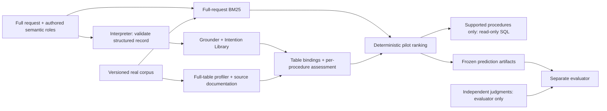

# Intention-grounded table discovery

**Main guide: runnable real-table Compare development pilot.** A full request and an explicit structured intention lead to IL procedures, BM25 candidates, source-backed table bindings, supported/violated/unresolved requirement verdicts, deterministic ranking and gated read-only SQL.

The demo uses **real official UCI tables**. Dashboard requests are authored demonstrations. The CLI also accepts natural-language input through the existing Groq Interpreter; live generation is budget-gated. Semantic mappings remain manually curated. Neither path supplies independent human usefulness gold. Effectiveness evaluation remains pending; SQL success and passing software tests do not establish retrieval superiority.

## Setup, acquire, launch

From this source checkout, with Python 3.10+:

```sh
python3 -m venv .venv
./.venv/bin/python -m pip install -e .
./.venv/bin/python -m intention_grounding.acquire
./.venv/bin/python -m intention_grounding.dashboard
```

Open **http://127.0.0.1:8765**. The two original ZIPs total under 1 MB; source-document snapshots are also cached. No API key, GPU, Node build or model download is needed. After acquisition, the meeting demo needs no network. Stop with Ctrl+C. Use `--port 8766` if needed; macOS users may double-click `run_demo.command` after setup.

Reconstruct/verify normalized tables from cached originals without downloading:

```sh
./.venv/bin/python -m intention_grounding.acquire --offline
```

Original downloads are immutable and checked against pinned SHA-256 values. Normalized data and profile caches live separately under ignored `data/` directories. A missing acquisition produces an explicit message; it is never silently replaced by synthetic data.

## Five-minute supervisor route

1. **Real datasets:** show why daily/hourly DC counts and hourly Seoul counts are related yet not interchangeable. Inspect source URL, license, original/normalized hashes, attributes, observation grain and limitations.
2. **Real-data discovery → `dc_daily`:** run the exact authored request. Inspect its input mode, validated record, grounded procedure, BM25 scores, table bindings, every verdict and evidence reference. The daily DC table supports values **985 and 801**; the difference is **−184**. Other candidates are rejected for documented incompatibilities.
3. **`dc_hourly_mean`:** show the explicit mean request, group counts, parameterized SQL and actual result. The hourly table is supported; the daily table has the wrong grain.
4. **`metadata_gap`:** semantic documentation is deliberately withheld as a diagnostic, while source provenance is retained. All candidates remain unresolved, the system abstains, and no SQL comparison executes.
5. **Verification / Models & study:** run the real offline suite, export a report, and explain why independent usefulness evaluation and model comparisons remain pending.

Other cases: `dc_daily_mean`, `statistic_ambiguous`, `no_population_match`, and `predict_pending`. Exact texts, structured roles and explicit diagnostic settings are in [demo-v1.json](data/requests/demo-v1.json). These are not gold labels. Library entries marked catalog-only must not be presented as implemented capabilities.

## Architecture and current scope



The existing dashboard and CLI share `discovery.run`, `grounder`, `profiler`, `aligner` and operator implementations. The synthetic replay pipeline remains a clearly labeled contract regression path, not a second discovery implementation.

| Stage | What genuinely works | Limit |
| --- | --- | --- |
| Interpretation | Natural-language CLI: one Groq call, exact-span validation, topical query and deterministic IL adapter. Explicit structured diagnostics remain. | Live verification blocked: no credentials, model ID or approved budget. Authored mock contract tests are not LLM accuracy. |
| IL grounding | Table-independent semantic roles select direct values, explicit group means, or explicitly accepted alternatives. | Unspecified statistics remain ambiguous; Predict remains unsupported. |
| Retrieval | Pinned MiniLM SBERT topical-query retrieval; full-request SBERT baseline uses identical table vectors. BM25 remains available. | MiniLM is an initial baseline, not an optimality claim. Qwen remains unintegrated. |
| Table evidence | Truthful local provenance, full scans, preserved empty CSV headers, boolean identity, explicit missing tokens/parse failures, version/content/config cache. | Semantic facts require explicit inspected source mappings; headers alone do not prove meaning. |
| Assessment | Per-procedure population, measure, unit, grain, observation kind, column binding, period, group coverage, numeric validity and uniqueness checks. | Narrow documented interval-count domain; no inferred causal or general predictive validity. |
| Ranking | Supported → unresolved → violated; selected retrieval score descending within state; table-ID tie-break; explicit ties and abstention. | Development policy, not a calibrated probability or validated optimum. |
| Execution | Quoted identifiers, parameterized values, in-memory SQLite, read-only authorizer; only supported procedures execute. | Observed intervals only; no imputation, complete-grid guarantee or causal claim. |
| Evaluation | Closed formats, split validation, separate gold reader, prediction hashes, reviewed-label gate and hand-checked metrics. | No independently reviewed usefulness judgments yet; no effectiveness scores reported. |

## Two implemented Compare procedures

**Scope change:** the researcher explicitly authorized group means in addition to direct observations. This supersedes the earlier direct-observation-only policy and requires a manuscript update. No catalog families were added.

| Procedure | When applicable | Requirements beyond common semantics |
| --- | --- | --- |
| `compare.documented_values.v1` | Documented values are explicitly requested at a fixed grain. | Exactly one valid scoped observation for every requested group; duplicates are not averaged. |
| `compare.group_mean.v1` | Arithmetic mean of observed interval counts is explicit. | Each group has valid observations; inputs are interval counts, not precomputed means; no silent missing-value omission. |

Common requirements cover documented meaning, compatible population/unit/grain, observed period, explicit column binding and complete scoped group inspection. Each verdict has resolving source-document or scan evidence. Absence is established only by a full scoped scan. A missing source mapping remains unresolved. Accepted procedure alternatives retain separate requirements and outcomes.

For the hourly mean example, bindings are `measure=cnt`, `group=workingday`, `date=dteday`:

```sql
SELECT "workingday", AVG("cnt") AS value, COUNT(*) AS n
FROM observations
WHERE "dteday" BETWEEN ? AND ? AND "workingday" IN (?,?)
GROUP BY "workingday" ORDER BY "workingday"
```

Parameters: `['2011-01-01', '2011-12-31', '1', '0']`. The UI also shows SQLite's actual instantiated statement. Identifiers come from inspected metadata and are quoted; arbitrary SQL is not accepted. A mean of hourly counts describes observed hourly intervals, not trip-level measurements or a causal working-day effect.

Verified against original archive rows using separate Decimal arithmetic:

| Group | Observed 2011 hours | Rental-count sum | Mean hourly count |
| --- | ---: | ---: | ---: |
| Working day (1) | 5,911 | 856,264 | 144.8594146506513 |
| Weekend/holiday (0) | 2,734 | 386,839 | 141.4919531821507 |

These are **execution diagnostics**, not independent suitability annotations or effectiveness results. Missing hours are not filled in.

## Why these datasets?

The [manifest](data/manifests/uci-bikes-v1.json) records the actual inspected files, retrieval dates, source pages, licenses, attributes, normalization, hashes, family relationships and limitations.

| Table | Inspected contents | Why selected / limitations |
| --- | --- | --- |
| [UCI 275](https://archive.ics.uci.edu/dataset/275/bike+sharing+dataset), `day.csv` | 731 daily observations, 2011–2012, Washington DC Capital Bikeshare; documented total count and working-day flag. | Supports daily values and means. Shares underlying source family with hourly data; cannot cross discovery partitions independently. |
| UCI 275, `hour.csv` | 17,379 observed hours, 2011–2012, same system; not a guaranteed complete hourly grid. | Supports mean observed hourly counts; meaningfully wrong-grain candidate for a direct daily request. |
| [UCI 560](https://archive.ics.uci.edu/dataset/560/seoul+bike+sharing+demand), `SeoulBikeData.csv` | 8,760 hourly observations, 2017-12-01–2018-11-30, Seoul; weather and functioning-day fields. | Same topic, distinct population/period. Useful incompatible candidate for DC requests and future prediction diagnostics. Non-functioning hours remain in the data. |

Both official pages state **CC BY 4.0**; give attribution and preserve the source citation. The DC archive also requests citation of Fanaee-T and Gama's dataset paper. Normalization preserves all rows/values, converts Seoul's Latin-1 text to UTF-8 and DD/MM/YYYY dates to ISO, and writes deterministic LF CSV. DC temperature/season descriptions conflict between its README and landing page; those fields are excluded from semantic binding. The landing-page instance count differs from the observed hourly count; the manifest uses the inspected file count.

Two source families within one topic are a **development-only pilot**. No credible held-out study is manufactured. OpenML mirrors would share their original family's identity; none were needed here. FollowTable remains a possible external study, subject to licensing/protocol/label compatibility. Legacy medical examples are not used in this demonstration.

## Run, verify, and prepare annotations

```sh
./.venv/bin/python -m intention_grounding.cli --mode discovery --case dc_daily --output outputs/discovery
./.venv/bin/python -m intention_grounding.cli --mode discovery --case dc_hourly_mean --output outputs/discovery
./.venv/bin/python -m intention_grounding.cli --mode discovery --case metadata_gap --output outputs/discovery
./.venv/bin/python -m intention_grounding.verify_demo --output outputs/demo-verification.json
./.venv/bin/python -m unittest discover -s tests -v
./.venv/bin/python -m intention_grounding.terminology
```

For a custom **structured** request use `--request path/to/request.json`; its closed format is [request.json](intention_grounding/schemas/request.json). `--no-execute` disables SQL; `--withhold-semantics` is an explicit missing-documentation diagnostic. Structured mode is an explicit diagnostic; use `--input` for the natural-language integration below. The legacy synthetic contract mode is `--mode offline` and is labeled synthetic.

Each discovery run exclusively creates `outputs/discovery/<run-id>/predictions.json` and its SHA-256 sidecar. Reports include exact request/input mode, IL/config/corpus/request hashes, candidates, every procedure/binding/verdict/evidence item, SQL/results, failures, abstention, timing and code identity. Caches are reusable; predictions are not overwritten. UI runs use `outputs/dashboard/` and can be exported.

Prepare **unjudged candidates**, replacing the example path with an actual run:

```sh
./.venv/bin/python -m intention_grounding.evaluation \
  --predictions outputs/discovery/ACTUAL_RUN_ID/predictions.json \
  --prepare-annotations /tmp/annotation-candidates.json
```

After genuine independent human review, use `--judgments /path/to/reviewed.json` instead. The evaluator verifies prediction hashes and corpus/request identity. It refuses to report metrics from generated/unreviewed candidates. The software cannot authenticate human independence; reviewer declarations and evidence must be audited externally.

Primary **usefulness nDCG@10** uses all useful tables in the fully judged corpus partition for IDCG. Also implemented: Success@1, Recall@10, candidate recall, coverage and failure counts. Unresolved/unjudged items make a request ineligible for primary metrics; they are never silently negative. Fully judged no-positive requests have undefined nDCG/recall and separate abstention/false-recommendation reporting. The runtime neither opens gold nor imports evaluation code; tests verify labels cannot affect predictions.

## Natural-language discovery and SBERT

Use a separate compatible environment (tested on this Intel Mac with Python 3.12); the existing `.venv` remains unchanged:

```sh
python3.12 -m venv .venv-sbert
./.venv-sbert/bin/python -m pip install -e '.[sbert,groq]'
./.venv-sbert/bin/python -m intention_grounding.acquire --offline
./.venv-sbert/bin/python -m intention_grounding.cli --input "Contrast recorded values of daily bike rental counts in rentals for Capital Bikeshare Washington DC on 2011-01-01 versus 2011-01-02." --retrieval sbert --no-execute --output outputs/natural-language
```

Set `GROQ_API_KEY` and `GROQ_MODEL_ID` through the existing environment configuration. The command reuses an exact matching cached response. **Only after a spending budget is approved**, add `--allow-live-generation` to permit one attempt with zero retries. Missing configuration/budget/model produces an explicit failed report; there is no fallback to authored roles, BM25 or another model. This implementation run made **zero live generation attempts**. No actual generative model identity is claimed because none was configured.

Omit `--no-execute` to allow SQL only for supported procedures. Select `--retrieval sbert-full` for full-request SBERT or `--retrieval bm25` for the lexical baseline. The natural-language default is topical-query SBERT. `--case` or `--request` selects an explicit structured diagnostic. `--mock-response PATH --input-id ID` explicitly supplies authored Interpreter output for contract testing; reports label that provenance. Input methods are mutually exclusive.

The adapter reuses the canonical Interpreter schema and exact-span checks. It preserves argument candidates and scope restrictions, derives the topical query from source fragments, and maps explicit statistics deterministically. Missing units/statistics/grain and unsupported scope restrictions cause abstention. Table IDs/columns never enter the model prompt. Request-to-IL grounding retains literal semantic roles; the later table assessment uses a small **manually curated vocabulary** (`semantic_bindings.py`) and documented table mappings. Unknown vocabulary remains unresolved. Date normalization handles explicit ISO dates/ranges and calendar years only. This conservative adapter is not general language understanding.

Table serialization `source-columns-semantics-first3-token-budgets-v2` includes source title/description, column names, documented semantics and the first three rows in immutable file order. Per-section budgets (16/32/48/64/64 tokens) prevent descriptions from consuming every input token. Reports record actual embedded text, section/model truncation, sample omissions, model revision and cache keys. Table vectors are normalized and cached by content hash, metadata hash, model/revision and serialization version; both SBERT query modes reuse those vectors. No profiles, requirement scores or judgment files enter embeddings. Similarity never certifies suitability.

Ranking retains the pilot state order, using SBERT cosine within each state when selected, followed by table-ID ties. The effective policy and original configuration have separate hashes. This is **not the final paper scoring design**.

Local verification used the real cached MiniLM model and real UCI tables with explicitly authored unseen-paraphrase mock interpretations: direct values 985/801, explicit hourly means 141.49195/144.85941, and abstention for unresolved input. These are integration/execution diagnostics, not live LLM accuracy or independently evaluated retrieval effectiveness. The dashboard remains the existing authored-case interface; this bounded integration is exposed through the CLI.

## Baselines, LLMs and Predict

| Method | Actual status / requirements |
| --- | --- |
| BM25 | Runnable full-request baseline and candidate stage; no external model. |
| SBERT MiniLM | Executed locally using cached `sentence-transformers/all-MiniLM-L6-v2`, revision `fa97f6e7cb1a59073dff9e6b13e2715cf7475ac9`; 384-dimensional normalized embeddings, CPU cosine similarity. Python 3.12 / torch 2.2.2 / sentence-transformers 3.0.1 / transformers 4.44.2 / numpy 1.26.4. |
| Qwen3-Embedding-0.6B | Not integrated; hardware preflight found Intel x86_64/16 GiB and no installed inference stack. A dry-run dependency resolution found no compatible torch>=2.6 wheel for macOS x86_64/Python 3.13. No alternate encoder substituted. Model download needs a compatible PyTorch/Transformers environment and measured memory/latency. |
| Qwen3 reranker | Not integrated; requires faithful pair formatting/scoring and identical candidates. |
| Published semantic matching / TABERTA | Blocked for faithful integration until exact artifacts, checkpoints and serialization are established. Generic cosine scores are not substitutes. |
| Direct LLM usefulness | Not implemented; would need matched public evidence, structured cited judgments, abstention and a declared spend budget. |
| Groq Interpreter | Connected to real discovery with one generation attempt and no retries; deterministic grounding makes no second call. Exact response, requested/returned model IDs, usage when available, evidence and timings are cached. No live calls executed: credentials, model ID and approved budget absent. |

For role selection and resource requirements see official [Groq output documentation](https://console.groq.com/docs/structured-outputs), [Qwen embedding card](https://huggingface.co/Qwen/Qwen3-Embedding-0.6B), and [Qwen reranker card](https://huggingface.co/Qwen/Qwen3-Reranker-0.6B). JSON validity does not establish semantic correctness. Record model/prompt revisions, tokens, retries, truncation, latency and cost. There is no measured best LLM here.

Predict remains visibly unsupported. The corpus has count outcomes and possible features, but that does not establish predictive validity. DC `casual`/`registered` reveal components of `cnt`; observed weather may not exist at forecast time; row/entity/time splits and future-availability policies must be specified before prediction. We did not delay verified Compare to claim broad Predict support.

## Canonical terminology and compatibility

New outputs use `intentions`, `intention_id`, `intention_instance_id`, `il_version`, `il_path`, `grounded_intention`, and `unresolved`. Extracted instance references and IL type identifiers have distinct meanings. Runtime library loading lives in `intention_library.py`; the current catalog is [IL v0.3](intention_grounding/library/intention-library-v0.3.json), with [two explicit operator contracts](intention_grounding/library/compare-procedures-v1.json).

Frozen older catalogs, schema and examples remain unchanged for provenance. Old formats require an **explicit** reader in `intention_grounding/legacy/`; the canonical loader does not silently accept them. New CLI uses `--il`, not the old flag. The terminology checker excludes only documented historical/readers and third-party APIs such as argparse's `action=` keyword. Raw external data names and published titles remain exact.

The existing 62-intention catalog was not expanded. Broad catalog entries are not executors. Direct-value and explicit-mean operators are the only new execution scope. No current manuscript is available; paper consistency is unverified. Required manuscript changes: terminology migration, the authorized mean procedure, scoped evidence/abstention policy, structured-request versus live-LLM distinction, development-only data strategy and separation of diagnostics from evaluated effectiveness.

## Repository map and remaining work

- `intention_grounding/cli.py`, `discovery.py`: one orchestration path and artifact writer.
- `interpreter/`, `grounder.py`, `intention_library.py`, `library/`: contracts, grounding and IL definitions.
- `acquire.py`, `profiler.py`, `contracts.py`, `schemas/`: reproducible data, profile cache and validation.
- `retrieval.py`, `aligner.py`, `procedures.py`: BM25, evidence assessment and SQL.
- `evaluation.py`: evaluator-only gold/metric boundary; `verify_demo.py`: original-row arithmetic diagnostics.
- `dashboard.py`, `dashboard_checks.py`, `ui/`: existing local interface and actual test reporting.
- `data/manifests/`, `data/requests/`, `data/splits/`, `configs/`: small versioned public artifacts; no gold in runtime bundles.
- `data/raw/`, `data/normalized/`, `data/runtime/`, `outputs/`, `.venv/`: ignored downloads, caches, runs and environment.
- `tests/`, `.github/workflows/`: offline fixtures and CI; no credentials or downloads required.

Remaining work: independent annotations/adjudication, broader source/topic families, reviewed semantic mappings, general language-to-procedure evaluation, faithful model baselines, validated ranking-policy selection and narrow Predict diagnostics. No effectiveness claim is warranted yet.

Supporting records: [checkpoint log](docs/PROGRESS.md), [evaluation contract](docs/EVALUATION_CONTRACT.md), [implementation status](docs/IMPLEMENTATION_PLAN.md), [IL reference](docs/INTENTION_LIBRARY.md), and [historical M0 audit](docs/REPOSITORY_AUDIT_M0.md). This README is authoritative for current behavior; dated historical statements are not current scope.
